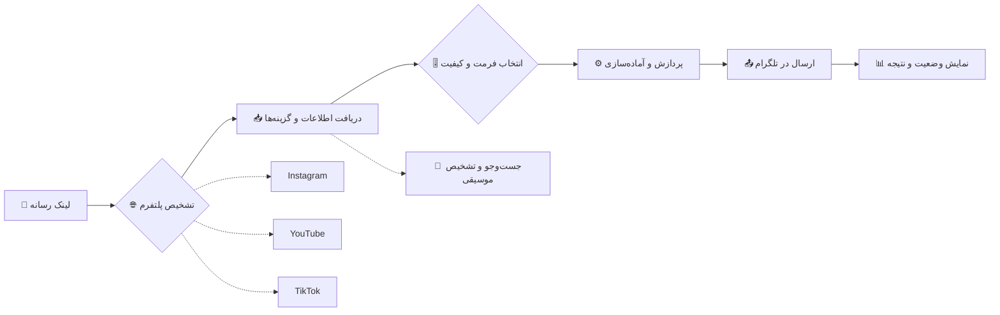
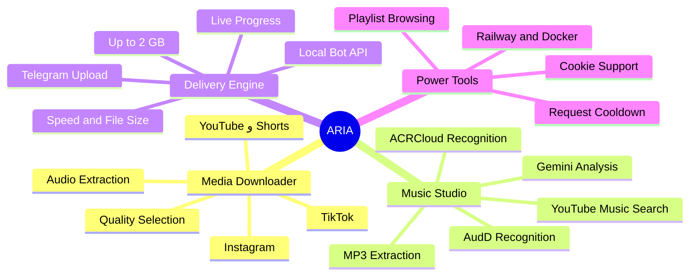

<div align="center">


<a href="https://github.com/akantkly-netizen/Aria.pro"></a>

### ⚡ لینک رو بفرست؛ کیفیت رو انتخاب کن؛ فایل رو تحویل بگیر.

<p>
  <a href="https://github.com/akantkly-netizen/Aria.pro"></a>
  <a href="https://github.com/akantkly-netizen/Aria.pro/network/members"></a>
  <a href="https://github.com/akantkly-netizen/Aria.pro/issues"></a>
  <a href="https://github.com/akantkly-netizen/Aria.pro/commits/main"></a>
</p>

<p>
  
  
  
  
</p>

<p>
  
  
  
</p>

<p>
  
  
  
  
</p>

<br/>

<table>
<tr>
<td align="center"><strong>📥 MULTI-PLATFORM</strong><br/>Instagram · YouTube · TikTok</td>
<td align="center"><strong>🎵 MUSIC INTELLIGENCE</strong><br/>Search · Extract · Recognize</td>
<td align="center"><strong>🚀 BIG FILES</strong><br/>Local Bot API · Up to 2 GB</td>
<td align="center"><strong>📊 LIVE FEEDBACK</strong><br/>Progress · Speed · Size</td>
</tr>
</table>

**[📚 راهنمای نصب](#-شروع-سریع) · [✨ قابلیت‌ها](#-قابلیت‌ها) · [⚙️ تنظیمات](#️-تنظیمات-و-متغیرهای-محیطی) · [🧯 رفع خطا](#-رفع-خطاهای-رایج)**

</div>

---

<div align="center">

## ◈ ARIA PIPELINE · از لینک تا فایل

**یک مسیر ساده برای تجربه‌ای کامل؛ از دریافت لینک تا تحویل رسانه در تلگرام.**

</div>



<div align="center">

| EXPERIENCE | WHAT YOU GET |
|:--|:--|
| **ONE BOT · MULTIPLE SOURCES** | دریافت رسانه از Instagram، YouTube و TikTok |
| **FORMAT CONTROL** | انتخاب کیفیت و دریافت نسخه صوتی در قابلیت‌های پشتیبانی‌شده |
| **MUSIC INTELLIGENCE** | جست‌وجو و شناسایی موسیقی با سرویس‌های معرفی‌شده در تنظیمات |
| **LARGE FILE DELIVERY** | پشتیبانی از Local Telegram Bot API برای فایل‌های تا ۲ گیگابایت |
| **TRANSPARENT PROCESS** | نمایش پیشرفت، سرعت و حجم در جریان دانلود |

</div>

<div align="center">

## ◈ ARIA FEATURE MAP · نقشه قابلیت‌ها

*تمام ابزارهای Aria در یک نگاه؛ بدون شلوغی، با مسیرهای مشخص.*



</div>

<details>
<summary><b>🧩 انتخاب مسیر مناسب — چه کاری می‌خواهی انجام بدهی؟</b></summary>

| هدفت | از این قابلیت استفاده کن |
|:--|:--|
| دریافت ویدیوی شبکه‌های اجتماعی | لینک را ارسال کن و کیفیت دلخواهت را انتخاب کن |
| گرفتن نسخه صوتی | گزینه صوتی یا استخراج MP3 را انتخاب کن |
| پیدا کردن یک آهنگ | جست‌وجوی موسیقی با نام آهنگ یا خواننده |
| شناسایی آهنگ داخل ویدیو | قابلیت تشخیص موسیقی با سرویس‌های تنظیم‌شده |
| مرور یک مجموعه ویدیویی | ارسال لینک پلی‌لیست YouTube |
| ارسال فایل بزرگ | راه‌اندازی Local Telegram Bot API |
| دسترسی به ویدیوی نیازمند ورود | تنظیم امن فایل کوکی |

</details>

<div align="center">

**ONE LINK. SMART PROCESSING. DIRECT DELIVERY.**

`SEND`　→　`CHOOSE`　→　`TRACK`　→　`RECEIVE`

</div>

---

---

## 🧭 فهرست مطالب

- [✨ معرفی پروژه](#-معرفی-پروژه)
- [🚀 قابلیت‌ها](#-قابلیت‌ها)
- [⚡ شروع سریع](#-شروع-سریع)
- [⚙️ تنظیمات و متغیرهای محیطی](#️-تنظیمات-و-متغیرهای-محیطی)
- [🎧 جست‌وجو و تشخیص موزیک](#-جستوجو-و-تشخیص-موزیک)
- [📃 مدیریت پلی‌لیست YouTube](#-مدیریت-پلیلیست-youtube)
- [📦 فایل‌های حجیم و Local Bot API](#-فایلهای-حجیم-و-local-bot-api)
- [🍪 پشتیبانی از کوکی](#-پشتیبانی-از-کوکی)
- [🛡️ مدیریت درخواست‌ها و پیام‌ها](#️-مدیریت-درخواستها-و-پیامها)
- [🚄 استقرار روی Railway](#-استقرار-روی-railway)
- [🧯 رفع خطاهای رایج](#-رفع-خطاهای-رایج)
- [🗂️ ساختار پروژه](#️-ساختار-پروژه)
- [⚖️ نکات حقوقی](#️-نکات-حقوقی)

---

## ✨ معرفی پروژه

**Insta Media Bot** یک ابزار چندمنظوره برای تبدیل لینک‌های رسانه‌ای به فایل‌های آماده دریافت در تلگرام است؛ از محتوای شبکه‌های اجتماعی تا جست‌وجو و شناسایی موسیقی. لینک را ارسال کن، گزینه‌های در دسترس را ببین، کیفیت یا فرمت دلخواهت را انتخاب کن و روند دریافت را تا لحظه تحویل فایل دنبال کن. همه‌چیز در یک گفت‌وگوی ساده، با کنترل بیشتر روی خروجی و نمایش شفاف وضعیت دانلود. 

<div align="center">

| 📥 دانلود محتوا | 🎵 ابزارهای موسیقی | 🧠 تشخیص هوشمند | 🚀 امکانات پیشرفته |
|:---:|:---:|:---:|:---:|
| Instagram | Music Search | Gemini | Live Progress |
| YouTube | MP3 Extraction | AudD / ACRCloud | Playlist Support |
| TikTok | Official Track | Song Detection | Local Bot API |

</div>

## 🚀 قابلیت‌ها

<table>
<tr>
<td width="50%" valign="top">

### 📲 دانلود از شبکه‌های اجتماعی

- دانلود پست، ریلز و استوری Instagram
- دانلود ویدیوهای YouTube و Shorts
- دانلود ویدیوهای TikTok
- انتخاب کیفیت‌های مختلف
- نمایش حجم فایل پیش از دانلود

</td>
<td width="50%" valign="top">

### 🎧 دنیای موسیقی

- جست‌وجوی آهنگ در YouTube Music
- دریافت آهنگ با نام خواننده یا عنوان
- استخراج MP3 از ویدیو
- تشخیص آهنگ اصلی و جست‌وجوی نسخه رسمی
- اولویت نسخه رسمی نسبت به Remix و Cover

</td>
</tr>
<tr>
<td width="50%" valign="top">

### 📊 تجربه کاربری بهتر

- نوار پیشرفت زنده دانلود
- نمایش درصد و حجم دانلودشده
- نمایش سرعت دانلود
- صفحه‌بندی نتایج جست‌وجو
- پاک‌سازی پیام‌ها پس از ارسال موفق

</td>
<td width="50%" valign="top">

### 🛠️ امکانات پیشرفته

- پشتیبانی از YouTube Playlist
- مدیریت درخواست‌های هم‌زمان
- محدودیت ضداسپم قابل تنظیم
- پشتیبانی از کوکی برای ویدیوهای محدودشده
- Local Telegram Bot API برای فایل‌های حجیم

</td>
</tr>
</table>

### 🧭 روند استفاده

<div align="center">

| 01 | 02 | 03 | 04 |
|:---:|:---:|:---:|:---:|
| 🔗 ارسال لینک | 🎚️ انتخاب کیفیت | 📊 مشاهده پیشرفت | 📥 دریافت فایل |
| لینک محتوا را بفرست | فرمت دلخواهت را انتخاب کن | دانلود را زنده دنبال کن | فایل را در تلگرام بگیر |

</div>

> [!TIP]
> فقط لینک را ارسال کن؛ ربات مراحل دریافت محتوا را مدیریت می‌کند و وضعیت دانلود را به‌صورت زنده نمایش می‌دهد.

---

## ⚡ شروع سریع

### پیش‌نیازها

- **Python 3.9 یا بالاتر**
- **FFmpeg**
- **توکن ربات تلگرام** از [@BotFather](https://t.me/BotFather)

برای ساخت ربات، وارد BotFather شو، دستور `/newbot` را اجرا کن و توکن ساخته‌شده را نگه دار.

### 1. دریافت پروژه

```bash
git clone https://github.com/USERNAME/REPOSITORY.git
cd REPOSITORY
```

### 2. ساخت محیط مجازی

```bash
python -m venv venv
```

فعال‌سازی در Linux و macOS:

```bash
source venv/bin/activate
```

فعال‌سازی در Windows PowerShell:

```powershell
.\venv\Scripts\Activate.ps1
```

### 3. نصب وابستگی‌ها

```bash
pip install -r requirements.txt
```

### 4. اجرای ربات

در Linux و macOS:

```bash
export TELEGRAM_BOT_TOKEN="YOUR_BOT_TOKEN"
python bot.py
```

در Windows PowerShell:

```powershell
$env:TELEGRAM_BOT_TOKEN="YOUR_BOT_TOKEN"
python bot.py
```

> [!IMPORTANT]
> مقدار `USERNAME/REPOSITORY` را با نام کاربری و نام مخزن GitHub خودت جایگزین کن. توکن ربات را محرمانه نگه دار و آن را در کد یا مخزن عمومی قرار نده.

---

## ⚙️ تنظیمات و متغیرهای محیطی

| متغیر | کاربرد | وضعیت |
|---|---|:---:|
| `TELEGRAM_BOT_TOKEN` | توکن ربات تلگرام | ضروری |
| `GEMINI_API_KEY` | تحلیل عنوان و کپشن برای تشخیص آهنگ | اختیاری |
| `AUDD_API_KEY` | شناسایی موزیک با AudD | اختیاری |
| `ACR_HOST` | میزبان سرویس ACRCloud | اختیاری |
| `ACR_ACCESS_KEY` | کلید دسترسی ACRCloud | اختیاری |
| `ACR_ACCESS_SECRET` | کلید محرمانه ACRCloud | اختیاری |
| `TELEGRAM_API_ID` | شناسه API تلگرام برای Local Bot API | اختیاری |
| `TELEGRAM_API_HASH` | هش API تلگرام برای Local Bot API | اختیاری |
| `COOKIES_FILE` | مسیر فایل کوکی در اجرای محلی | اختیاری |
| `COOKIES_FILE_B64` | محتوای Base64 کوکی برای Railway | اختیاری |
| `REQUEST_COOLDOWN_SECONDS` | فاصله زمانی درخواست‌های کاربر | پیش‌فرض: ۲۰ |

<details>
<summary><b>🔐 نمونه فایل متغیرهای محیطی</b></summary>

```env
TELEGRAM_BOT_TOKEN=YOUR_BOT_TOKEN
GEMINI_API_KEY=
AUDD_API_KEY=
ACR_HOST=
ACR_ACCESS_KEY=
ACR_ACCESS_SECRET=
TELEGRAM_API_ID=
TELEGRAM_API_HASH=
COOKIES_FILE=
COOKIES_FILE_B64=
REQUEST_COOLDOWN_SECONDS=20
```

</details>

> [!CAUTION]
> کلیدها، توکن‌ها و کوکی‌ها اطلاعات محرمانه‌اند. آن‌ها را داخل کد، فایل README یا مخزن عمومی GitHub قرار نده.

---

## 🎧 جست‌وجو و تشخیص موزیک

### 🔎 جست‌وجوی آهنگ

برای پیدا کردن نسخه مناسب آهنگ، جست‌وجو ابتدا از YouTube Music آغاز می‌شود و در صورت پیدا نشدن نتیجه، امکان بررسی YouTube معمولی هم وجود دارد:

- جست‌وجو با نام آهنگ یا فقط نام خواننده
- نمایش نتایج در صفحه‌های ۱۰تایی
- امکان جست‌وجو در YouTube معمولی در صورت پیدا نشدن نتیجه
- اولویت نسخه رسمی آهنگ نسبت به Remix، Cover و Live؛ مگر اینکه خودت همان نسخه‌ها را بخواهی

> [!NOTE]
> دانلود مستقیم از Spotify پشتیبانی نمی‌شود؛ محتوای این سرویس تحت DRM است. برای دریافت آهنگ از منابعی مانند YouTube یا SoundCloud استفاده می‌شود.

### 🧠 تشخیص آهنگ از روی ویدیو

یک ویدیو بفرست؛ Aria مسیر شناسایی موسیقی آن را مرحله‌به‌مرحله بررسی می‌کند. بسته به سرویس‌هایی که پیکربندی کرده‌ای، این فرایند می‌تواند شامل مراحل زیر باشد:

1. استخراج صدای ویدیو
2. بررسی اطلاعات و عنوان ویدیو
3. تحلیل عنوان یا کپشن با Gemini، در صورت تنظیم API Key
4. بررسی بخش‌هایی از صدا، از جمله ابتدا و میانه، با AudD یا ACRCloud
5. تلاش برای پیدا کردن نسخه رسمی آهنگ و ارسال آن در کنار ویدیو

اگر شناسایی آهنگ به نتیجه نرسد، اطلاعاتی که امکان استخراجشان وجود دارد ــ مانند نام هنرمند ــ نمایش داده می‌شود. همچنین تگ‌های فایل صوتی تا حد امکان مرتب و یکدست تنظیم می‌شوند.

### 🔌 اتصال سرویس‌های تشخیص موزیک

| سرویس | دریافت کلید | متغیر |
|---|---|---|
| Gemini | [Google AI Studio](https://aistudio.google.com/) | `GEMINI_API_KEY` |
| AudD | [AudD Dashboard](https://dashboard.audd.io/) | `AUDD_API_KEY` |
| ACRCloud | [ACRCloud Console](https://console.acrcloud.com/) | `ACR_HOST` و کلیدها |

برای ACRCloud یک پروژه از نوع **Audio & Video Recognition** بساز. این سرویس‌ها اختیاری‌اند و برای دانلودهای پایه لازم نیستند.

---

## 📃 مدیریت پلی‌لیست YouTube

با ارسال لینک پلی‌لیست YouTube، اطلاعات مجموعه دریافت و ویدیوهای آن به‌شکل فهرست صفحه‌بندی‌شده نمایش داده می‌شوند؛ تا بتوانی راحت‌تر میان موارد موجود جابه‌جا شوی.

| ویژگی | جزئیات |
|---|---|
| 🖼️ اطلاعات پلی‌لیست | نمایش عنوان و تصویر |
| 📚 صفحه‌بندی | نمایش ۵ ویدیو در هر صفحه |
| 🚫 موارد نامعتبر | ویدیوهای خصوصی یا حذف‌شده نادیده گرفته می‌شوند |
| 🔢 سقف بررسی | حداکثر ۳۰۰ ویدیوی اول |

> [!NOTE]
> اگر لینک یک ویدیو را همراه پارامتر `&list` ارسال کنی، همان ویدیو انتخاب می‌شود؛ نه اینکه کل پلی‌لیست به‌صورت خودکار دانلود شود.

---

## 📦 فایل‌های حجیم و Local Bot API

برای عبور از محدودیت حجم فایل در Bot API رسمی، پروژه امکان استفاده از **Local Telegram Bot API** را فراهم می‌کند. این مسیر در فرایند Docker پروژه پیش‌بینی شده و در صورت راه‌اندازی موفق، امکان ارسال فایل‌های بسیار بزرگ‌تر را فراهم می‌کند.

### فعال‌سازی

از [Telegram API Development Tools](https://my.telegram.org/) شناسه و هش API را دریافت کن و این دو متغیر را تنظیم کن:

```env
TELEGRAM_API_ID=YOUR_API_ID
TELEGRAM_API_HASH=YOUR_API_HASH
```

### قابلیت‌های حالت محلی

- سرور Local Bot API از سورس، داخل فرایند Docker ساخته و اجرا می‌شود.
- اگر سرور محلی سالم باشد، ربات از آن استفاده می‌کند و از نشست API ابری خارج می‌شود.
- اگر راه‌اندازی سرور محلی ناموفق باشد، ربات به API رسمی برمی‌گردد.
- پس از خروج از API ابری، در صورت شکست حالت محلی، تا ۱۰ دقیقه امکان تلاش مجدد برای استفاده از API ابری وجود ندارد.
- در حالت محلی، مسیر فایل روی دیسک به سرور داده می‌شود و نیازی نیست کل فایل از طریق HTTP منتقل شود.
- برای عملیات ارسال، مهلت زمانی ۳۰ دقیقه‌ای در نظر گرفته شده است.
- درخواست‌های هم‌زمان پشتیبانی می‌شوند.
- اندازه فایل قابل پشتیبانی در این حالت می‌تواند تا ۲ گیگابایت باشد.

<div align="center">

### 📊 مقایسه حالت‌های API

| حالت | محدودیت ارسال فایل |
|:---|:---:|
| Telegram Bot API رسمی | ۵۰ مگابایت |
| Local Telegram Bot API | **تا ۲ گیگابایت** |

</div>

> [!WARNING]
> سرور Local Bot API ممکن است هنگام Build حدود ۵ تا ۱۵ دقیقه زمان نیاز داشته باشد. هر دو سرویس باید در یک کانتینر و روی شبکه محلی در دسترس باشند. اگر متغیرهای API را تنظیم نکنی، ربات از API رسمی استفاده می‌کند.

می‌توانی اطلاعات حساس را در فایلی محلی مانند `local_secrets.sh` نگه داری؛ اما این فایل نباید وارد Git شود.

---

## 🍪 پشتیبانی از کوکی

بعضی ویدیوهای YouTube بدون احراز هویت در دسترس نیستند. برای این موارد، می‌توانی کوکی حساب خودت را در فایل `cookies.txt` قرار بدهی تا ربات در صورت نیاز از آن برای تلاش مجدد استفاده کند.

### اجرای محلی

```env
COOKIES_FILE=/path/to/cookies.txt
```

### استفاده در Railway

ابتدا فایل کوکی را به Base64 تبدیل کن و خروجی را در متغیر `COOKIES_FILE_B64` قرار بده.

Linux و macOS:

```bash
base64 -w0 cookies.txt
```

Windows PowerShell:

```powershell
[Convert]::ToBase64String([IO.File]::ReadAllBytes("cookies.txt"))
```

ربات ابتدا بدون کوکی تلاش می‌کند و فقط در صورت مواجهه با چالش ورود یا احراز هویت، تلاش مجدد با کوکی را انجام می‌دهد.

> [!CAUTION]
> فایل کوکی ممکن است دسترسی حساب کاربری‌ات را در اختیار دیگران قرار دهد. آن را منتشر نکن، در Git آپلود نکن و در صورت افشای آن نشست‌های مربوط را باطل کن. کوکی‌ها ممکن است منقضی شوند و نیاز به استخراج دوباره داشته باشند.

---

## 🛡️ مدیریت درخواست‌ها و پیام‌ها

### ضداسپم و مدیریت درخواست‌ها

برای کنترل درخواست‌های پیاپی و کاهش فشار روی ربات، یک فاصله زمانی پیش‌فرض ۲۰ ثانیه‌ای بین درخواست‌ها در نظر گرفته شده است. این مقدار قابل تنظیم است و می‌توان آن را متناسب با نیاز اجرا تغییر داد.

- شمارنده پیام درخواست و شمارنده شروع عملیات جداگانه مدیریت می‌شوند.
- جابه‌جایی بین صفحه‌ها و دکمه پایان، تایمر درخواست جدید ندارند.
- مقدار محدودیت از طریق `REQUEST_COOLDOWN_SECONDS` قابل تغییر است.
- با تنظیم مقدار `0` محدودیت زمانی غیرفعال می‌شود.

### پاک‌سازی هوشمند پیام‌ها

وقتی فایل با موفقیت ارسال شد، ربات پیام‌های موقت مربوط به عملیات را مرتب می‌کند تا گفت‌وگو خلوت و نتیجه نهایی واضح باقی بماند:

- پیام وضعیت ربات پاک می‌شود.
- پیام حاوی لینک ارسالی کاربر نیز پاک می‌شود.
- دکمه 🔗 لینک زیر فایل قرار می‌گیرد.

اگر ارسال فایل با خطا مواجه شود، پیام‌ها پاک نمی‌شوند تا کاربر بتواند خطا را مشاهده کند.

**در گروه‌ها:** برای حذف پیام کاربران، ربات باید ادمین باشد و مجوز حذف پیام‌ها را داشته باشد.

---

## 🚄 استقرار روی Railway

Aria با ساختار Docker قابلیت استقرار روی [Railway](https://railway.app/) را دارد. کافی است مخزن را متصل کنی، متغیرهای محیطی را تنظیم کنی و فرایند Deploy را اجرا کنی.

### مراحل Deploy

1. پروژه را در GitHub قرار بده.
2. در Railway یک پروژه جدید بساز و مخزن GitHub را متصل کن.
3. روش Build را روی Dockerfile قرار بده.
4. متغیرهای محیطی موردنیاز را در بخش Variables وارد کن.
5. سرویس را Deploy کن و لاگ‌ها را بررسی کن.

<div align="center">

**نیازی به دامنه یا پورت عمومی نیست.**

ربات با روش Polling کار می‌کند.

</div>

### Procfile

```procfile
worker: python bot.py
```

### نکات مهم Railway

- `Dockerfile` برای نصب وابستگی‌ها و اجرای ربات استفاده می‌شود.
- `start.sh` راه‌اندازی ربات و Local Bot API را مدیریت می‌کند.
- فایل‌های موقت پس از پایان کار با `shutil.rmtree` پاک‌سازی می‌شوند.
- می‌توانی Deploy خودکار برای شاخه `main` را فعال کنی.
- محدودیت‌های پلن رایگان Railway ممکن است روی زمان اجرا و منابع اثر بگذارند.

---

## 🧯 رفع خطاهای رایج

<details>
<summary><b>❌ خطای Deno یا The page needs to be reloaded</b></summary>

نسخه‌های جدید yt-dlp برای برخی استخراج‌های YouTube به JavaScript runtime نیاز دارند.

```bash
pip install -U "yt-dlp[default]"
```

مطمئن شو Deno نصب شده و در PATH قرار دارد. سپس پروژه را با Build بدون کش دوباره Deploy کن.

</details>

<details>
<summary><b>🚫 خطای 403 یا محدودیت دسترسی YouTube</b></summary>

اگر با خطای 403 یا محدودیت دسترسی روبه‌رو شدی، این موارد را به‌ترتیب بررسی کن؛ علت می‌تواند به احراز هویت، نسخه ابزار استخراج یا محدودیت‌های سمت YouTube مربوط باشد:

1. ابتدا بدون کوکی تلاش کن.
2. اگر ویدیو به ورود نیاز دارد، کوکی معتبر تنظیم کن.
3. در صورت پشتیبانی نسخه yt-dlp، روش استخراج `android_vr` را بررسی کن.
4. لاگ‌ها را برای خطاهای Deno و احراز هویت بررسی کن.
5. اگر کوکی منقضی شده، آن را دوباره استخراج کن.

در بعضی شرایط محدودیت شبکه یا نیاز به Residential Proxy و سرویس‌دهنده PO Token نیز ممکن است مطرح باشد.

</details>

<details>
<summary><b>🔄 به‌روزرسانی yt-dlp</b></summary>

```bash
pip install -U "yt-dlp[default]"
```

پس از به‌روزرسانی، ربات را دوباره اجرا یا Deploy کن.

</details>

<details>
<summary><b>🎞️ مشکل FFmpeg</b></summary>

مطمئن شو FFmpeg نصب شده و دستورهای `ffmpeg` و `ffprobe` در PATH سیستم قابل اجرا هستند:

```bash
ffmpeg -version
ffprobe -version
```

</details>

---

## 🗂️ ساختار پروژه

```text
insta_bot/
├── bot.py
├── requirements.txt
├── Dockerfile
├── start.sh
├── nixpacks.toml
├── Procfile
├── .gitignore
└── README.md
```

## ⬆️ ارسال پروژه به GitHub

بعد از ساخت مخزن در GitHub:

```bash
git init
git add .
git commit -m "Initial commit"
git branch -M main
git remote add origin https://github.com/USERNAME/REPOSITORY.git
git push -u origin main
```

مطمئن شو فایل‌های حساس در `.gitignore` باشند:

```gitignore
venv/
__pycache__/
.env
*.pyc
cookies.txt
local_secrets.sh
```

اگر قبلاً کوکی یا کلید محرمانه را در مخزن عمومی قرار داده‌ای، حذف فایل از آخرین commit کافی نیست؛ کلیدها و نشست‌های افشاشده را تعویض یا باطل کن.

---

## 🚀 Aria Pro Control Plane — زیرساخت مدیریت دانلود

Aria Pro حالا یک سرویس مستقل و قابل استقرار برای مدیریت دانلودهای رسانه‌ای هم دارد. این زیرسامانه در کنار ربات فعلی اجرا می‌شود و برای حفظ سازگاری، فایل اجرایی قدیمی را جایگزین یا دست‌کاری نمی‌کند.

### معماری و قابلیت‌های عملیاتی

- **FastAPI Gateway:** رابط HTTP نسخه‌بندی‌شده با مستندات OpenAPI
- **Persistent Job Queue:** صف پایدار مبتنی بر SQLite WAL؛ درخواست‌ها پس از Restart باقی می‌مانند
- **Concurrent Workers:** پردازش هم‌زمان قابل تنظیم با وضعیت و درصد پیشرفت
- **Media Engine:** دریافت رسانه با کیفیت‌های `best`، `720p`، `480p` و استخراج `MP3`
- **Lifecycle Management:** پیگیری، لغو، بازیابی و دریافت خروجی هر Job
- **Security Layer:** توکن Bearer، allowlist دامنه، بررسی DNS و رد مقصدهای خصوصی برای کاهش ریسک SSRF
- **Production Container:** Docker غیر root، healthcheck، فایل‌سیستم فقط‌خواندنی و volume پایدار
- **Automated Tests:** تست چرخه Job، تنظیمات، اعتبارسنجی URL و احراز هویت API

### اجرای مستقل API

```bash
pip install -r requirements-api.txt
export ARIA_API_TOKEN="$(python -c 'import secrets; print(secrets.token_urlsafe(48))')"
python -m aria_core
```

یا با Docker Compose:

```bash
export ARIA_API_TOKEN="$(python -c 'import secrets; print(secrets.token_urlsafe(48))')"
docker compose -f docker-compose.api.yml up -d --build
```

### نمونه ساخت Job

```bash
curl -X POST http://127.0.0.1:8000/api/v1/jobs \
  -H "Authorization: Bearer $ARIA_API_TOKEN" \
  -H "Content-Type: application/json" \
  -d '{"url":"https://www.youtube.com/watch?v=VIDEO_ID","quality":"720p"}'
```

مسیرهای اصلی: `GET /health`، `POST /api/v1/jobs`، `GET /api/v1/jobs/{id}`، `DELETE /api/v1/jobs/{id}` و `GET /api/v1/jobs/{id}/file`.

📚 **راهنمای کامل نصب، API، تنظیمات و عملیات:** [`aria_core/README.md`](aria_core/README.md) · [نقشه معماری](docs/architecture.md)

> این سرویس مستقل است؛ اجرای آن نیازمند `ARIA_API_TOKEN` است و به نشست تلگرام یا اطلاعات محرمانه ربات وابسته نیست. برای دسترسی عمومی، حتماً از TLS و Reverse Proxy استفاده کن و پورت خام API را مستقیم روی اینترنت منتشر نکن.

---

## 🤝 مشارکت در توسعه Aria

Aria با ایده‌ها و مشارکت جامعه متن‌باز بهتر می‌شود. اگر پیشنهادی برای بهبود داری، باگی پیدا کرده‌ای یا می‌خواهی در توسعه سهیم شوی، از مسیرهای زیر اقدام کن؛ هر مشارکت، قدمی برای بهتر شدن پروژه است.

<div align="center">

<a href="https://github.com/akantkly-netizen/Aria.pro/issues"></a>
<a href="https://github.com/akantkly-netizen/Aria.pro/pulls"></a>
<a href="https://github.com/akantkly-netizen/Aria.pro"></a>

</div>

---

## ⚖️ نکات حقوقی

این ابزار برای استفاده شخصی و دریافت محتوایی طراحی شده که مالک آن هستی یا اجازه دانلودش را داری. مسئولیت رعایت حق نشر، شرایط استفاده و قوانین پلتفرم‌های مربوط بر عهده کاربر است.

---

<div align="center">

## 💜 اگر این پروژه برات مفید بود...

### ⭐ به مخزن GitHub ستاره بده!

**ساخته‌شده با Python، کمی خلاقیت و کلی انرژی ⚡**


</div>
