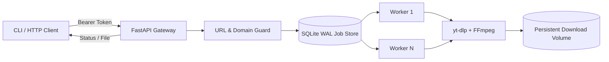

# Aria Pro — Architecture & Operations

## Runtime topology

## Job lifecycle

`queued → running → succeeded | failed | cancelled`

- Job creation is persisted before the API returns `202 Accepted`.
- Workers claim jobs transactionally with SQLite `BEGIN IMMEDIATE`, preventing duplicate claims across worker tasks.
- Progress hooks update byte counts, percentage, estimated total and speed.
- Running jobs are returned to the queue after an unclean process restart; cancellation requests are finalized as cancelled.
- Output paths are resolved and constrained to the configured download directory before a file is served.

## Security boundaries

- Every `/api/v1` route requires a random bearer secret (32+ characters) and constant-time comparison.
- URL intake requires HTTPS and an explicit media-domain allowlist; DNS answers must all be globally routable.
- The service rejects custom ports, embedded credentials and private/link-local destinations.
- Downloads have a configurable upper size bound, socket timeout and bounded retry count.
- Docker runs as an unprivileged user with dropped Linux capabilities, a read-only root filesystem and a persistent data volume.
- No cookies, browser profiles, Telegram sessions or third-party credentials are accepted by this API.

## Operational notes

- SQLite WAL is intended for a single service instance with local persistent storage, not multiple replicas sharing a network filesystem.
- Run one Uvicorn process; internal worker concurrency is controlled by `ARIA_WORKERS`.
- Keep the API behind TLS/reverse proxy and do not expose the bearer token in browser URLs or logs.
- Install FFmpeg and a supported JavaScript runtime for extractors that require them. The supplied container includes FFmpeg and Node.js.
- Respect platform terms, copyright and the rights of content owners.
